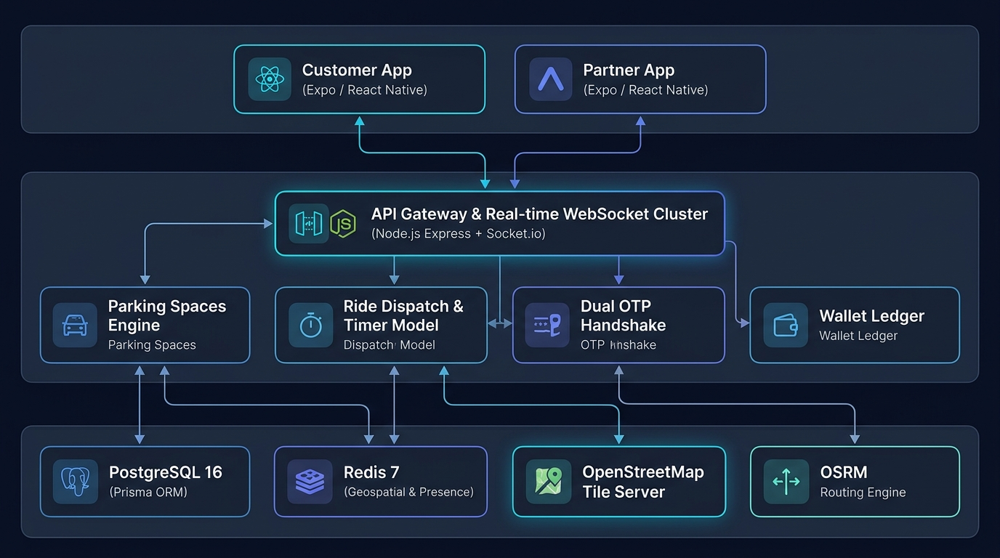
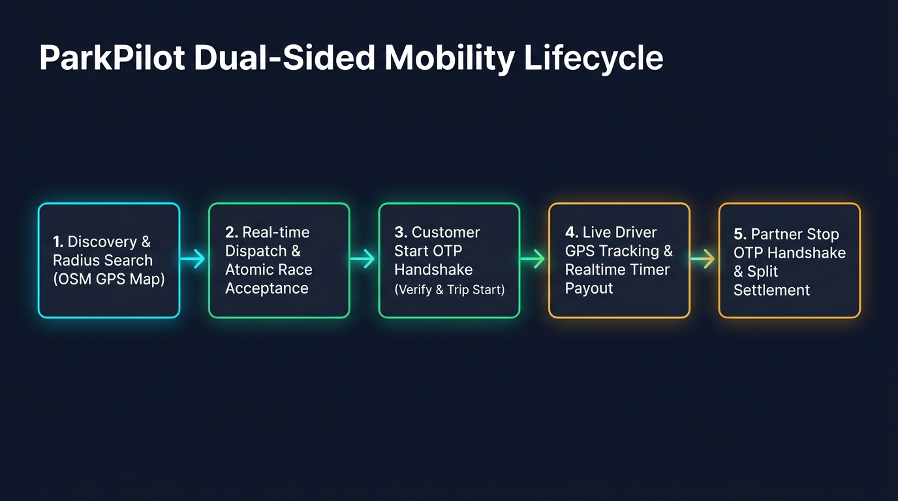

# ParkPilot — SmartDrive & Park Network



<div align="center">

[](https://www.typescriptlang.org/)
[](https://reactnative.dev/)
[](https://expo.dev/)
[](https://expressjs.com/)
[](https://socket.io/)
[](https://www.postgresql.org/)
[](https://www.prisma.io/)
[](https://redis.io/)
[](https://www.docker.com/)
[](https://jestjs.io/)

**Enterprise-grade dual-sided urban mobility & smart parking platform built as a clean TypeScript monorepo.**  
*Customers hire professional drivers on-demand by time (timer model with cryptographic dual OTP handshake) and book peer-to-peer parking slots.*  
*Partners accept ride requests, broadcast live GPS, run the fare timer, and host parking spaces with real-time availability sync.*

[Quick Start](#-quick-start-zero-to-running-in-2-minutes) • [Architecture](#-system-architecture) • [Features](#-key-features--platform-capabilities) • [Real-time Protocol](#-real-time-synchronization-engine) • [API Docs](#-rest-api-reference) • [Testing](#-testing--quality-assurance)

</div>

---

## 📑 Table of Contents

1. [Platform Overview](#-platform-overview)
2. [System Architecture](#-system-architecture)
3. [Dual-Sided Mobility Lifecycle](#-dual-sided-mobility-lifecycle)
4. [Key Features & Platform Capabilities](#-key-features--platform-capabilities)
   - [Customer Mobile Application](#1-customer-mobile-application-appscustomer)
   - [Partner Mobile Application](#2-partner-mobile-application-appspartner)
5. [Real-time Synchronization Engine](#-real-time-synchronization-engine)
6. [Tech Stack & Architecture Decisions](#-tech-stack--architecture-decisions)
7. [Quick Start (Zero to Running in 2 Minutes)](#-quick-start-zero-to-running-in-2-minutes)
8. [Side-by-Side Mobile Simulators for Demos](#-side-by-side-mobile-simulators-for-demos)
9. [Pre-Seeded Test Accounts](#-pre-seeded-test-accounts)
10. [Monorepo Structure](#-monorepo-structure)
11. [REST API Reference](#-rest-api-reference)
12. [Timer Billing Math & Dual OTP Security](#-timer-billing-math--dual-otp-security)
13. [Building Standalone Android APKs (EAS)](#-building-standalone-android-apks-eas)
14. [Testing & Quality Assurance](#-testing--quality-assurance)
15. [Production Deployment Checklist](#-production-deployment-checklist)
16. [Troubleshooting Guide](#-troubleshooting-guide)

---

## 🌟 Platform Overview

ParkPilot solves two critical metropolitan transportation problems through a unified platform:

1. **Peer-to-Peer Parking (P2P Parking)**:
   - Hosts monetize unused driveways, basement slots, or commercial parking spaces with custom hourly rates.
   - Customers search parking across radius filters (5–100 km) with live GPS centering, preview driving routes with turn-by-turn ETAs, launch Google Maps navigation, and pay through an in-app animated checkout modal.
   - **Zero-Latency Availability Sync**: When a partner pauses or deletes a space, it instantly disappears from the customer app in real-time via WebSockets.

2. **On-Demand Professional Drivers (Timer Model)**:
   - Fixed platform rate (**₹150/hr** base).
   - Customers book estimated hours; final billing is determined by actual elapsed trip time with a **1-hour minimum charge** and per-minute precision.
   - **Cryptographic Dual OTP Handshake**: A start OTP gates trip commencement (preventing false starts), and a stop OTP gates trip termination (preventing unauthorized overcharging).

---

## 🏛 System Architecture

The monorepo uses a decoupled micro-modular architecture connecting cross-platform mobile apps to an event-driven Node.js backend backed by persistent PostgreSQL and in-memory Redis:

- **Client Layer (`apps/*`)**: Two dedicated Expo React Native applications for Customers and Partners sharing design system tokens and navigation patterns.
- **Shared Packages (`packages/*`)**: Reusable domain logic, API clients with transparent 401 token refresh, custom Leaflet map bridge, and UI components.
- **API Gateway & Real-time Layer**: Express REST services alongside a Socket.io WebSocket cluster managing private and shared event rooms.
- **Persistence & State**: PostgreSQL 16 managed via Prisma ORM for ACID transaction ledgers, paired with Redis 7 for high-speed geospatial indexing (`GEOADD`/`GEORADIUS`) and driver presence.
- **Mapping & Routing**: Zero-cost, keyless OpenStreetMap tile server with OSRM driving polyline and ETA engine.

---

## 🔄 Dual-Sided Mobility Lifecycle



### End-to-End Workflow Stages

1. **Discovery & Radius Search**:
   - Customer searches nearby parking or drivers across 5–100 km radial zones.
   - Server performs geospatial matching against Redis GEO (drivers) and PostgreSQL (parking spaces).
2. **Atomic Dispatch & Acceptance**:
   - Open bookings are dispatched to nearest online partners.
   - Race-safe atomic acceptance serialized at the database level (`UPDATE ... WHERE status='REQUESTED'`); exactly one winner gets `200 OK`, while others receive `409 Conflict`.
3. **Driver Arrival & Start OTP Verification**:
   - Partner arrives at pickup location and triggers "Reached".
   - Server mints a 4-digit **Start OTP** delivered strictly to the customer's personal socket room.
   - Customer recites the code; partner enters it to transition the booking to `ONGOING` and start the timer.
4. **Live GPS Tracking & Elapsed Fare Metering**:
   - Partner broadcasts GPS coordinates at ~0.5 Hz to the tracking room.
   - Both client and server calculate running costs in real-time ($₹150$/hr base rate with integer paise math and first-hour minimum).
5. **Trip Completion, Stop OTP & Settlement**:
   - Customer initiates "End Trip"; server mints a 4-digit **Stop OTP** delivered strictly to the partner.
   - Partner recites the code; customer verifies it on their device.
   - Server seals the booking as `COMPLETED`, computes final bill splits (80% partner payout, 20% platform commission), and triggers payment settlement.

---

## 🚀 Key Features & Platform Capabilities

### 1. Customer Mobile Application (`apps/customer`)

* **Find Parking (Park Tab)**:
  - Interactive Leaflet / OpenStreetMap view initialized to customer's live GPS coordinates.
  - Radial distance filter chips (**5 km, 10 km, 25 km, 50 km, 100 km**).
  - Tappable parking space cards showing title, reverse-geocoded landmark address, distance in km, and hourly pricing badge.
  - **Expandable Route Preview**: Tapping **"See route"** opens a dedicated driving mini-map with real-time route polyline, driving distance, and live ETA without cluttering the main map.
  - **External Google Maps Navigation**: Tapping **"Google Maps"** seamlessly launches native Google Maps turn-by-turn navigation.
  - **In-App Checkout Modal**: Animated payment sheet supporting UPI (Google Pay, PhonePe, Paytm) and Credit/Debit cards with simulated payment settlement.
* **Driver on Demand (Ride Tab)**:
  - 3-step booking wizard: Duration selection -> Interactive pickup pin placement -> Instant quote review at ₹150/hr.
  - Restores active trip state automatically across app reloads, crashes, or tab switches.
* **Live Trip Tracking (Trips & Tracking Tab)**:
  - Real-time car icon movement as the driver approaches.
  - Displays customer's 4-digit **Start OTP** securely (hidden from driver payloads).
  - Synchronized live stopwatch timer and real-time running fare counter.
* **Profile & History**:
  - Full booking ledger with filters for ongoing, completed, and canceled bookings.

---

### 2. Partner Mobile Application (`apps/partner`)

* **Parking Space Management (Spaces Tab)**:
  - List parking spaces with automatic high-accuracy GPS geocoding.
  - **Instant Real-Time Pause / Activate**: Single-tap toggle to take spaces off the market. Pausing instantly hides the slot from customers; activating brings it back immediately.
  - **Repin to Current GPS**: Relocate existing slots to the partner's current live coordinates.
  - **Delete Space**: Permanently remove a parking space with active booking guards and safety confirmation.
* **Driver Requests Inbox (Requests Tab)**:
  - Online / Offline presence toggle with instant status persistence in Redis.
  - Incoming driver requests sorted **nearest-first** with distance badges and pickup route preview.
  - Single-winner atomic acceptance (simultaneous requests resolve to exactly one winner; losers receive `409 booking_already_taken`).
* **Active Ride & Meter (Ride Tab)**:
  - Background-friendly live GPS broadcasting toggle.
  - "Reached" button mints the customer's Start OTP.
  - Start OTP input with automated vibration/shake feedback on invalid codes.
  - Real-time partner earnings meter updating every second based on platform commission split (80% partner take).
  - End trip verification via partner's Stop OTP.
* **Wallet & KYC**:
  - Live earnings balance and completed trips history.
  - Identity verification stepper with document status tracking.

---

## ⚡ Real-Time Synchronization Engine

ParkPilot relies on a **Dual Delivery Architecture**:
1. **Fast-Path**: Instant WebSocket event emission via Socket.io.
2. **Convergence-Path**: Automatic background polling (every 4–8 seconds) and tab-focus re-sync.

### WebSocket Rooms Architecture

| Room Name | Scope | Description |
|---|---|---|
| `user:{userId}` | Private User | Authentication, personal alerts, start OTPs for customers, stop OTPs for partners. |
| `driver:{partnerId}` | Private Partner | Direct driver dispatches and private route assignments. |
| `booking:{bookingId}` | Shared Booking | Shared room for both customer and assigned partner during active trips. |
| `tracking:{driverId}` | Public Tracking | Customer subscribes to receive live driver coordinate updates (`driver:moved`). |
| `partners` | Broadcast Group | All online partners for presence broadcasts. |

### Real-Time Event Matrix

| Event | Origin | Destination | Description |
|---|---|---|---|
| `space:changed` | Partner Action | All Connected Clients | Fired on space create, pause (`isActive: false`), activate (`isActive: true`), and delete. |
| `partner:online` | Partner | Server | Registers partner in Redis GEO and `partners:online` presence set. |
| `partner:offline` | Partner | Server | Removes partner from active dispatch rotation. |
| `driver:location` | Partner App | Server | Throttled (0.5 Hz) GPS ping updating Redis GEO coordinates. |
| `driver:moved` | Server | Tracking Room | Broadcasts `{ driverId, lat, lng, at }` to customer for smooth map animation. |
| `booking:request` | Server | Driver Room | Pushes incoming ride request to nearest online drivers. |
| `booking:accepted` | Server | Booking Room | Notifies customer and locks booking from other drivers. |
| `booking:start-otp` | Server | Customer Room Only | Delivers 4-digit trip start code securely to customer. |
| `booking:stop-otp` | Server | Partner Room Only | Delivers 4-digit trip completion code securely to partner. |
| `booking:updated` | Server | Booking Room | Broadcasts state transitions (`ONGOING`, `COMPLETED`, `CANCELLED`). |

---

## 🛠 Tech Stack & Architecture Decisions

| Component | Technology | Rationale |
|---|---|---|
| **Monorepo** | npm Workspaces | Clean cross-package dependency sharing without Turborepo/Nx overhead. |
| **Mobile Runtime** | React Native 0.86 + Expo 52 | Single codebase for iOS, Android, and Web with native performance. |
| **Backend** | Node.js + Express 4 (TypeScript) | High throughput, asynchronous I/O, robust middleware ecosystem. |
| **Real-time** | Socket.io 4 | Built-in rooms, heartbeat, automatic reconnection, and acknowledgment callbacks. |
| **Database** | PostgreSQL 16 + Prisma 5 | ACID compliance, relational integrity, strict type generation, and versioned migrations. |
| **Cache & State** | Redis 7 (`ioredis`) | High-speed GEO indexing (`GEOADD`, `GEORADIUS`), presence sets, and low-latency ephemeral state. |
| **Map Rendering** | Leaflet + OpenStreetMap (WebView) | 100% keyless, zero billing limits, renders identically on Web and Expo Go. |
| **Routing & Geocoding** | OSRM + Nominatim | Free driving distance calculation, ETAs, and reverse-geocoded landmark names. |

---

## ⚡ Quick Start (Zero to Running in 2 Minutes)

### Prerequisites

- **Node.js**: v20.x or higher
- **Docker & Docker Compose**
- **npm** (comes with Node.js)

### Step 1: Clone and Configure Environment

```bash
git clone https://github.com/Aaravchaturvedi/ParkPilot.git
cd ParkPilot
cp .env.example .env
```

### Step 2: Start Backend & Database Stack

```bash
# Starts PostgreSQL (5432), Redis (6379), and Backend (4000)
# Auto-runs Prisma migrations and idempotent database seeding
docker compose up -d
```

Verify backend health:
```bash
curl http://localhost:4000/health
# Response: {"status":"ok","service":"smartdrive-backend",...}
```

### Step 3: Run Both Mobile Apps

Open two terminal tabs:

**Terminal 1 (Customer App):**
```bash
cd apps/customer
npx expo start --port 8081
# Press 'w' to launch Web in browser, or scan QR code in Expo Go
```

**Terminal 2 (Partner App):**
```bash
cd apps/partner
npx expo start --port 8082
# Press 'w' to launch Web in browser, or scan QR code in Expo Go
```

---

## 💻 Side-by-Side Mobile Simulators for Demos

For presentations, testing, and LinkedIn screen recording, launch two side-by-side Chrome windows formatted as phone screens (420×890):

```bash
npm run simulators
```

This script:
1. Opens the **Customer App** (`http://localhost:8081`) on the left half of your screen.
2. Opens the **Partner App** (`http://localhost:8082`) on the right half of your screen.
3. Automatically sets clean mobile viewport dimensions for perfect side-by-side demonstration.

---

## 👥 Pre-Seeded Test Accounts

Every time the Docker container starts, `backend/src/services/seed.ts` automatically provisions verified test accounts:

| Role | Email | Password | Phone | Default State |
|---|---|---|---|---|
| **Customer 1** | `customer1@gmail.com` | `Password123` | `+919800000001` | KYC Verified, active wallet balance |
| **Customer 2** | `customer2@gmail.com` | `Password123` | `+919800000002` | KYC Verified, active wallet balance |
| **Customer 3** | `customer3@gmail.com` | `Password123` | `+919800000003` | KYC Verified, active wallet balance |
| **Partner 1** | `partner1@gmail.com` | `Password123` | `+919900000001` | KYC Verified, Hyundai i20, GPS slot in Delhi |
| **Partner 2** | `partner2@gmail.com` | `Password123` | `+919900000002` | KYC Verified, Honda City, GPS slot in Delhi |
| **Partner 3** | `partner3@gmail.com` | `Password123` | `+919900000003` | KYC Verified, Tata Harrier, GPS slot in Delhi |

---

## 📁 Monorepo Structure

```
ParkPilot/
├── apps/
│   ├── customer/                  # Customer Expo application
│   │   ├── App.tsx                # Session gate, persistent socket, overlay manager
│   │   ├── app.config.js          # Dynamic Expo configuration
│   │   └── src/screens/           # MapScreen, BookRideScreen, ParkingScreen, TrackingScreen, TripsScreen
│   └── partner/                   # Partner Expo application
│       ├── App.tsx                # Session gate, presence manager, polling sync
│       └── src/screens/           # RequestsScreen, RideScreen, HostScreen, WalletScreen, KycScreen
├── packages/
│   ├── api/                       # Axios client, auth helpers, booking APIs, host APIs
│   ├── mobile/                    # SafeMap (OSM Leaflet iframe), socket singleton, session provider
│   ├── types/                     # Shared TypeScript interfaces, math models, enum definitions
│   └── ui/                        # Reusable design system: Button, Card, Field, OtpInput, Modals
├── backend/
│   ├── Dockerfile                 # Debian-slim container with Prisma 5 and OpenSSL 3
│   ├── prisma/
│   │   ├── schema.prisma          # Relational data schema (User, Vehicle, ParkingSpace, Booking)
│   │   └── migrations/            # Versioned PostgreSQL database migrations
│   └── src/
│       ├── controllers/           # HTTP handlers for auth, bookings, pricing, spaces, wallet
│       ├── routes/                # Express router declarations
│       ├── services/              # Business logic (bookings, pricing, spaces, seed)
│       └── sockets/               # Real-time dispatch, location tracking, presence handlers
├── scripts/
│   ├── launch-simulators.sh       # Dual-window Chrome mobile emulator runner
│   └── dev-tunnel.sh              # Cloudflare tunnel helper for remote physical device testing
├── __tests__/                     # Jest test suites (unit, mock, and component tests)
├── docs/                          # Architecture diagrams, test runbooks, maps documentation
├── docker-compose.yml             # Postgres, Redis, and backend service orchestration
└── package.json                   # Root monorepo workspace configuration
```

---

## 🔌 REST API Reference

Base URL: `http://localhost:4000`  
Authentication: `Authorization: Bearer <accessToken>`

### Authentication & Users
* `POST /auth/register` — Register a new account (`name`, `email`, `password`, `role`).
* `POST /auth/login` — Login with credentials; returns public user and JWT tokens (`accessToken`, `refreshToken`).
* `POST /auth/refresh` — Exchange refresh token for fresh access token.
* `GET /auth/me` — Retrieve authenticated user profile.
* `PATCH /auth/kyc` — Submit KYC verification documents.

### Parking Spaces
* `GET /spaces/nearby?lat={lat}&lng={lng}&radiusKm={km}` — Search active parking spaces sorted nearest-first.
* `POST /spaces` — Create a new parking space (`title`, `address`, `lat`, `lng`, `pricePerHourPaise`).
* `GET /spaces/mine` — Retrieve all spaces owned by authenticated partner.
* `PATCH /spaces/:id` — Update parking space parameters, GPS repin (`lat`, `lng`), or pause/activate (`isActive`).
* `DELETE /spaces/:id` — Permanently delete parking space (protected against active bookings).

### Bookings & Driver Dispatch
* `POST /bookings` — Create a driver booking (`hours`, `pickupLat`, `pickupLng`) or parking booking (`spaceId`, `hours`).
* `GET /bookings` — List bookings for current user (customer or partner).
* `GET /bookings/:id` — Get detailed booking payload with viewer-scoped OTP redaction.
* `PATCH /bookings/:id/accept` — Atomic partner accept with race protection (`409` if already taken).
* `POST /bookings/:id/start-otp` — Partner mints Start OTP (delivered exclusively to customer).
* `POST /bookings/:id/start-verify` — Partner submits 4-digit code to transition booking to `ONGOING`.
* `POST /bookings/:id/stop-otp` — Customer mints Stop OTP (delivered exclusively to partner).
* `POST /bookings/:id/stop-verify` — Customer submits 4-digit code to complete trip and calculate final bill.
* `PATCH /bookings/:id/cancel` — Cancel booking prior to trip start.
* `PATCH /bookings/:id/pay` — Mark completed booking as paid via simulated settlement.

### Pricing & Wallet
* `GET /pricing/quote?type=driver_hours&hours={h}` — Calculate estimated quote and commission splits.
* `GET /pricing/quote?type=parking&pricePerHourPaise={p}&hours={h}` — Calculate parking fee.
* `GET /wallet` — Retrieve wallet balances, earnings, and trip payouts.

---

## 🧮 Timer Billing Math & Dual OTP Security

### Billing Algorithm
All financial transactions are calculated in **integer paise** (₹1 = 100 paise) to eliminate floating-point rounding errors:

$$\text{elapsedMinutes} = \left\lceil \frac{\text{endedAt} - \text{startedAt}}{60} \right\rceil$$

$$\text{billedMinutes} = \max(60, \text{elapsedMinutes})$$

$$\text{totalPaise} = \left\lceil \frac{\text{billedMinutes} \times \text{pricePerHourPaise}}{60} \right\rceil$$

$$\text{platformFeePaise} = \left\lfloor \frac{\text{totalPaise} \times \text{commissionBps}}{10000} \right\rfloor$$

$$\text{partnerPayoutPaise} = \text{totalPaise} - \text{platformFeePaise}$$

* Standard platform commission is 2000 basis points (**20%**).
* The first hour is charged as a non-negotiable minimum; subsequent minutes are billed proportionally.

### Dual OTP Cryptographic Scoping
- **Start OTP**: Generated on the server upon partner arrival. It is emitted **strictly** to `user:{customerId}`. It is redacted from all partner-facing REST responses and public broadcasts.
- **Stop OTP**: Generated on the server when the customer triggers trip completion. It is emitted **strictly** to `driver:{partnerId}`. It is redacted from customer-facing payloads.

---

## 📱 Building Standalone Android APKs (EAS)

Both apps include pre-configured Expo Application Services (EAS Build) profiles for standalone Android `.apk` distribution:

```bash
# Build Customer Standalone APK
cd apps/customer
npx eas-cli build -p android --profile preview

# Build Partner Standalone APK
cd apps/partner
npx eas-cli build -p android --profile preview
```

- Cleartext traffic is enabled via `expo-build-properties` to permit local LAN development.
- Built-in dynamic fallback handles emulator loopbacks (`10.0.2.2:4000`) and LAN IPs automatically.

---

## 🧪 Testing & Quality Assurance

### 1. Mobile Unit & Component Tests
Run the comprehensive mobile test suite:
```bash
npm run test:mobile
```
* **Coverage**: 10 test suites containing **51 passing unit tests** verifying screen rendering, geocoding fallback, distance calculations, timer billing mirrors, auth validation, and state recovery.

### 2. Backend Integration & Protocol Tests
Run live integration tests against the local backend:
```bash
BASE=http://localhost:4000 npx tsx backend/scripts/socket-test.ts
BASE=http://localhost:4000 npx tsx backend/scripts/presence-test.ts
BASE=http://localhost:4000 npx tsx backend/scripts/dispatch-test.ts
BASE=http://localhost:4000 npx tsx backend/scripts/location-test.ts
```

---

## 🛡️ Production Deployment Checklist

To transition ParkPilot from local development to cloud production:

1. **Managed Database**: Switch `DATABASE_URL` from local Docker to a managed PostgreSQL cluster (AWS RDS, Neon, or Supabase) with PgBouncer connection pooling.
2. **Managed Redis**: Point `REDIS_URL` to an enterprise Redis cluster (AWS ElastiCache or Upstash) with high availability and persistence.
3. **Environment Secrets**: Generate a cryptographically secure 64-byte `JWT_SECRET`:
   ```bash
   openssl rand -hex 64
   ```
4. **SSL / Reverse Proxy**: Deploy the backend behind Nginx, AWS ALB, or Cloudflare with automated Let's Encrypt SSL/TLS certificates.
5. **Self-Hosted OSRM**: Replace the public demo routing endpoint with a self-hosted OSRM container seeded with OpenStreetMap region data (`.osm.pbf`).
6. **Payment Gateway Integration**: Replace mock payment state flips in `backend/src/services/bookings.ts` with real Razorpay or Stripe Webhooks.

---

## ❓ Troubleshooting Guide

| Issue | Root Cause | Solution |
|---|---|---|
| **Map shows blank or white box** | Leaflet iframe blocked or no network connection for OSM tiles | Verify internet connection; check browser console for iframe sandbox permissions. |
| **"Cannot reach server" on mobile** | Device cannot connect to host's LAN IP | Run `npm run dev:tunnel` and restart Expo, or check if both devices are on the exact same Wi-Fi network. |
| **Space does not appear after adding** | Space pinned far from customer or radius filter too small | Tapping "Repin" in Partner app updates slot to current GPS; expand Customer search radius to 50km+. |
| **Driver request not appearing in Partner inbox** | Partner is marked "Offline" | Toggle presence switch to **Online** in Partner app's Requests tab. |
| **Two partners accept at the same time** | Natural race condition | Handled gracefully: first request acquires DB lock; second receives `409 booking_already_taken` and card dismisses automatically. |
| **Babel SyntaxError on run** | Stale Metro bundler cache | Clear cache with `npx expo start -c`. |

---

<div align="center">
  <sub>Built with ❤️ by the ParkPilot Engineering Team. Open-source under MIT License.</sub>
</div>
